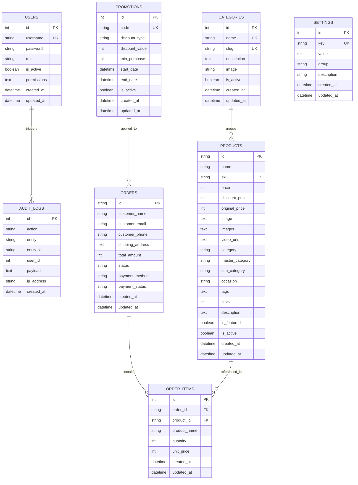

# HampersNest Database Architecture & Schema Design

## 1. Overview
The **HampersNest Database** is designed to power the e-commerce store and admin management system. It utilizes **Knex.js** as the SQL query builder and migration engine, supporting PostgreSQL, MySQL, SQLite3, and Oracle DB seamlessly.

---

## 2. Entity-Relationship Diagram (ERD)

---

## 3. Schema Conventions
- **Table Names**: Lowercase, plural, snake_case (`users`, `orders`, `order_items`).
- **Primary Keys**:
  - Auto-incrementing integers (`id`) for internal tables (`users`, `categories`, `promotions`, `settings`).
  - UUID / Prefixed strings (`id`) for externally exposed entities (`products`, `orders`).
- **Timestamps**: Every table contains `created_at` and `updated_at` timestamps using ISO 8601 formatting.
- **Foreign Keys**: Enforce referential integrity with cascading or nullifying options:
  - `orders` -> `order_items` (`ON DELETE CASCADE`)
  - `products` -> `order_items` (`ON DELETE SET NULL`)

