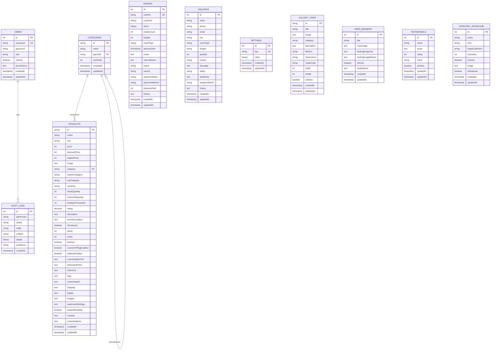

# HampersNest Database Architecture & Schema Design

## 1. Overview
The **HampersNest Database** powers the e-commerce storefront and admin dashboard. It uses **Knex.js** as the query builder and migration engine, targeting **Oracle Autonomous Cloud Database** for Production and **in-memory SQLite** for fast automated tests.

---

## 2. Production Entities & Tables (11 Tables)

